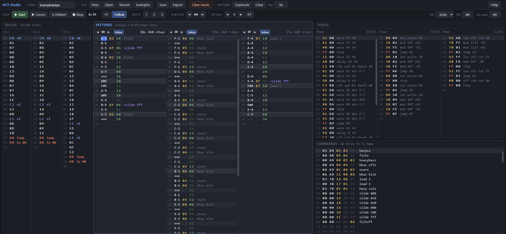

# NT2 Studio

A modern, cross-platform music editor for the **NinjaTracker V2.03** Commodore 64 playroutine
by Cadaver (Lasse Öörni). It runs in any current browser on Windows, macOS and Linux.



- Tracker-style editing of tracks, patterns, wave/pulse/filter tables and commands, with the
  original editor's keys plus mouse support, row selection, undo/redo and all three channels
  visible side by side.
- An instrument editor (the **Sounds** switch in the toolbar): each command shown as an instrument
  with an envelope, and its wave, pulse and filter programs as steps with sliders and draggable
  graphs. It edits the same commands and tables as the hex view, so the two can be mixed freely.
- Playback runs the **original 6502 playroutine** inside the WebSid emulator, so what you hear
  is the real player code. Edits are applied while the tune plays.
- Reads and writes the original editor's song format (including songs on `.d64` disk images),
  so songs move freely between this editor and the C64 editor.
- Exports `.sid`, `.prg` (player + music at any address) and gamemusic data for `nt2play.s`.
- **4k intro export:** KickAssembler source with a player cut down to what the song uses and
  data laid out to crunch well (see below).

## Running

```
npm install
npm run dev      # development server on http://localhost:5173
npm run build    # static site in dist/, can be hosted from any folder
npm test         # core, sound engine, import and 4k export checks
```

Press **F8** in the app for the key and data format reference. **Examples** loads the four
tunes from the NinjaTracker V2.03 disk.

## How it works

| Part | File |
|---|---|
| Song model, pattern/track/table encodings | `src/core/song.ts` |
| Original song file format ("N2" + RLE) | `src/core/songfile.ts` |
| `.d64` reader | `src/core/d64.ts` |
| Small 6502 assembler used to relocate the player | `src/core/asm6502.ts` |
| The playroutine source (from `nt2packer.s`) | `src/core/playersrc.ts` |
| Packer: SID / PRG / gamemusic / editor memory image | `src/core/packer.ts` |
| 4k intro export (player template, pruning, frequency table) | `src/core/export4k.ts` |
| Check of a 4k export against the normal player | `src/core/verify4k.ts` |
| Import of packed tunes (.sid, .prg, gamemusic) | `src/core/sidimport.ts` |
| WebSid wrapper and frame-by-frame playback engine | `src/audio/` |
| Editor state, rendering, keyboard and files | `src/ui/`, `src/main.ts` |

For playback the editor builds a SID file with the player and a fixed, maximum-size data layout,
loads it into WebSid, and then writes changed bytes straight into the emulated C64's memory.
Test notes are triggered the same way the original editor does it.

`scripts/verify.ts` checks the core against files from the original distribution: the example songs load
and re-save to the same song, the gamemusic export matches the shipped `gamemusic.bin`, and the
packed tunes run in a 6502 core. `scripts/websid-smoke.ts` runs the playback engine and exported
`.sid` files through the real WebSid WebAssembly build under Node.

## 4k intro export

For intros where every byte counts. The export writes one `.asm` file in KickAssembler syntax:
`jsr nt_init` once, then `jsr nt_play` once per frame. It holds one subtune of at most 255
pattern rows and plays once from a freshly loaded copy (there is no restart).

- Player code for unused features (filter, pulse, slide, vibrato, wave delay, legato, transpose)
  is left out; unused patterns, commands and table rows are dropped and renumbered.
- Patterns are a note stream with command prefix bytes and a duration column, addressed by one
  8-bit offset. Tunes with legato commands or more than 31 commands get three columns instead.
- The frequency table is stored as its highest used octave and halved down by `nt_init`, when
  that is smaller than the full table with unused entries zeroed.
- Before saving, the editor plays the export next to the normal one in a 6502 core and compares
  every SID write.

`node scripts/export4k-check.ts` runs that comparison for every song in `songs/`. With
`--kickass path/to/KickAss.jar` it also assembles each export with KickAssembler and compares the
bytes with the built-in assembler.

## Songs and scripts

`songs/` holds tunes written with the editor. Most are generated from note lists in
`scripts/make-songs.ts`. The other scripts are checks (`npm test`) and tools for looking at a
song: `probe-commands.ts`, `section-levels.ts`, `compare-sid.ts`, `drift-check.ts`,
`drift-engine.ts`. Some of them default to a real-world `.sid` that is not in the repository;
pass your own file as the first argument.

## Working with it

- **Files:** Open, drag and drop, or Examples. Packed NinjaTracker 2 tunes (.sid, packed .prg,
  gamemusic data) are imported back into editable songs, without command names. Save writes back to the opened file in Chrome and
  Edge (Ctrl+Shift+S saves as) and downloads a copy elsewhere. A song replaced by New, Open or
  Examples is kept under Recent. The bar length is remembered per song.
- **Playback:** Start (F1), from the cursor (F6: the cursor row of a pattern, or the track cursor),
  loop one pattern (F9; showing another pattern in that column switches the loop to it), stop (F3).
  Each pattern column has a mute switch; Shift+click it to solo that channel.
- **Follow:** each pattern column has a follow switch; editing in a channel during playback
  switches that channel's follow off until you turn it back on.
- **Patterns:** rows show the duration they inherit, dimmed, with bar and beat lines. Duplicate
  (Ctrl+D), Clear, and Clear music (keeps the instruments). Patterns no track plays are marked unused.

## Limits and known differences

- PAL timing only (50 Hz).
- Exports are checked by emulation, not on a real C64.
- Importing packed tunes finds the tables by the player's instruction patterns; it is checked with the
  V2.03 player and one real-world .sid from a slightly different 2.x build. Tunes packed by players
  before V2.03 may import with durations one frame off.
- No sound effect editing.
- While typing a command name, Shift+digit panel shortcuts type characters; use Tab to leave the name.

## Credits and licences

- NT2 Studio's own code is under the **MIT licence** (see `LICENSE`). The bundled parts below keep
  their own terms; `THIRD-PARTY-NOTICES.md` lists the files.
- NinjaTracker V2.03 playroutine, song format and example tunes: Cadaver (Lasse Öörni),
  <http://covertbitops.c64.org>. NinjaTracker is freeware; customization is allowed.
  `public/examples.d64` is the disk image from that distribution and `scripts/fixtures/gamemusic.bin`
  its packed example tune.
- SID / C64 emulation: **WebSid (Tiny'R'Sid)** © Jürgen Wothke,
  <https://bitbucket.org/wothke/websid>, licensed **CC BY-NC-SA 4.0**. `public/websid/` contains
  its unmodified prebuilt WebAssembly and glue code with the ScriptNodePlayer adapter class
  removed. Because of this licence the app as distributed with WebSid is for non-commercial use,
  and derived versions must keep the same licence and attribution.
